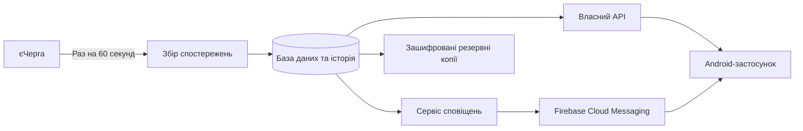

# AvelRen

**Черги на кордоні. Історія спостережень. Сповіщення водієві.**

Репозиторій проєкту моніторингу вантажних черг на кордоні України.

[Про проєкт](#про-проєкт) · [Архітектура](#архітектура) · [Доступ до ключів](docs/SECRETS-RECOVERY.md) · [План перенесення](docs/MIGRATION.md) · [Правила роботи](CONTRIBUTING.md)

---

> **Робочий репозиторій: `ikstv/AvelRen`.**
> Це єдине актуальне джерело коду та документації проєкту. [Реєстр готовності](docs/RELEASE-READINESS.md) відділяє підтверджене серверне приймання від ще відкритих Android, телефонних і Google Play перевірок. Історичні записи перенесення збережено в [плані](docs/MIGRATION.md) та [контрольному списку](docs/MIGRATION-REMAINING.md).

## Про проєкт

AvelRen допомагає стежити за станом вантажних черг: бачити поточні показники, переглядати їхню динаміку та отримувати сповіщення за обраними умовами. Сервер накопичує спостереження щохвилини, а Android-застосунок отримує дані через власний API проєкту.

Застосунок неофіційний. Показники залежать від первинного джерела; перед поїздкою їх варто перевірити в офіційному сервісі. Розрахункові прогнози мають бути чітко відокремлені від виміряних даних.

| Напрям | Призначення |
| :--- | :--- |
| Android-застосунок | Поточна черга, графік змін, персональний моніторинг і сповіщення |
| Сервер | Збір спостережень, історія та API для застосунку |
| Експлуатація | Контроль стану сервісу, резервні копії та перевірка відновлення |

## Архітектура

Схема описує основні компоненти проєкту.

До первинного джерела звертається лише серверний збирач. Застосунок працює через наш API. Кожен цикл збору записується, зокрема невдалий.

Джерело даних — [єЧерга](https://echerha.gov.ua/). Перевірений порядок отримання даних, заголовки та обмеження описані в [контракті інтеграції](INTEGRATION.md). Перед змінами діють [правила агентів і розробників](AGENTS.md).

## Ключі та доступ

Агенте, перед запитом паролів у власника прочитай [AGENTS.md](AGENTS.md)
і [інструкцію отримання ключів](docs/SECRETS-RECOVERY.md).
Після входу GitHub CLI потрібний комплект отримується однією командою,
наприклад `.\tools\Get-ProjectSecret.ps1 -Name android`.

## Організація роботи

Код і поточна документація підтримуються в цьому репозиторії. Історичні плани та аудити зберігаються для простежуваності; кожну нову зміну оформлюємо окремим перевірюваним кроком українською.

- [План перенесення](docs/MIGRATION.md): послідовність, запропонована структура та критерії готовності.
- [Правила роботи](CONTRIBUTING.md): мова, зміни, перевірки та основні технічні обмеження.
- [Аудит перед перенесенням](docs/AUDIT.md): перевірені розбіжності, відкриті питання та порядок виправлень.
- [Контрольний аудит](docs/CONTROL-AUDIT.md): перевірка перенесеного та незавершені матеріали обох джерел.
- [Android](apps/android/README.md): перенесена база 0.1.1, окремі тести та [плашка стану сервера](docs/SERVER-STATUS.md).
- [Що має дійти до телефона](docs/RELEASE-READINESS.md): усі нововведення, блокери та перевірка перед релізом.
- [Аудит нового репозиторію](docs/NEW-REPO-AUDIT.md): перевірені частини, знайдені проблеми та межі готовності.
- [Доступ до ключів і відновлення](docs/SECRETS-RECOVERY.md): єдина точка входу для Android-підпису та серверних секретів.
- [Резервування та відновлення сервера](ops/RECOVERY.md): перевірені передумови, історичні розбіжності та план ізольованого rehearsal. Runbook не запускає production.

Перевірки розділені за компонентами: repository, core, database, API, watchdog та Android. Фільтри шляхів запускають відповідні набори; спільні зміни потребують ширшої перевірки.

## Стан перенесення

| Етап | Стан |
| :--- | :--- |
| Українське оформлення та початкова документація | Підготовлено |
| Інвентаризація коду, гілок, тегів, PR та відкритих питань | Аудит підготовлено; [код звітності та журнал БД звірено із сервером](docs/PRODUCTION-AUDIT.md) |
| Перенесення компонентів і розділення перевірок | Основні компоненти, Android, runtime, backup/restore у main; залишки в [контрольному списку](docs/MIGRATION-REMAINING.md) |
| Перевірка збірки, сумісності та експлуатаційних процедур | Ізольовані перевірки успішні; реальний backup, сервер і фінальний APK мають окреме приймання |
| Єдине актуальне джерело коду | `ikstv/AvelRen` |

Старі назви репозиторіїв у датованих аудитах і посиланнях є історичним контекстом, а не альтернативним місцем для нових змін. Видалення старих репозиторіїв не є частиною цього кроку.

---

**Розробник: Танько Віктор**

Інтерфейс проєкту — ROAD SIGN: зелений означає доступність, жовтий привертає увагу, червоний позначає проблему.

